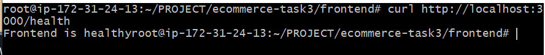
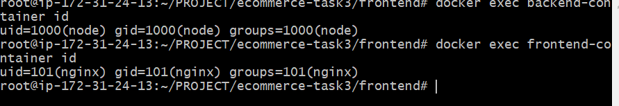

Task 3: Dockerize E-Commerce Application
1. Project Overview
Project: E-Commerce Web Application
Architecture: MERN Stack
Deployment Environment: AWS EC2 / Ubuntu Linux
Containerization: Docker

The objective of Task 3 was to containerize the E-Commerce application using Docker and run the frontend, backend, and MongoDB database in separate containers.

The task also focused on Docker networking, persistent storage, container security, troubleshooting, and application health verification.

2. Technology Stack
Frontend: React.js

Backend: Node.js and Express.js

Database: MongoDB

Containerization: Docker

Web Server: Nginx

Cloud Platform: AWS EC2

Operating System: Ubuntu Linux

3. Dockerfile Configuration
Dockerfiles were used to package the application components into Docker images.

Backend Dockerfile
The backend Dockerfile uses a multi-stage build approach.

Uses Node.js Alpine as the base image.

Installs production dependencies.

Copies the application code into the runtime image.

Sets NODE_ENV=production.

Runs the application as a non-root node user.

Exposes port 5000.

Starts the application using node server.js.

Frontend Dockerfile
The frontend Dockerfile builds the React application and uses Nginx to serve the production files.

Builds the React frontend application.

Uses Nginx as the production web server.

Runs the frontend container as the non-root nginx user.

Uses container port 8080, mapped to host port 3000.

Verification: the backend runs as user node and the frontend runs as user nginx.

4. Docker Images
Docker images were created for the frontend and backend components.

Build Commands
docker build -t ecommerce-backend ./backend

docker build -t ecommerce-frontend ./frontend

Verify Docker Images
docker images

Images verified in the screenshots:

Image

Tag

ecommerce-backend

latest

ecommerce-frontend

latest

mongo

7

Result: All three required Docker images were available on the EC2 instance.

5. Docker Container Configuration
The frontend, backend, and MongoDB components were configured to run in separate Docker containers.

Component

Container Name

Port

Frontend

frontend-container

3000:8080

Backend

backend-container

5000:5000

MongoDB

mongo-container

27017

Run Backend Container
docker run -d \
  --name backend-container \
  --network backend_network \
  --env-file ../.env \
  -p 5000:5000 \
  ecommerce-backend

Verify Running Containers
docker ps

Result:

The screenshots confirm that the frontend, backend, and MongoDB containers were running successfully.

6. Docker Networking
A custom Docker network was created to enable communication between the backend and MongoDB containers.

Create Docker Network
docker network create backend_network

Verify Docker Network
docker network ls

Result:

The custom network backend_network was successfully created using the bridge driver.

Connect Backend Container to Network
docker network connect ecommerce_network backend-container

The backend was connected to the required Docker network for application communication.

MongoDB Connection Configuration
The backend was configured to connect to MongoDB using the MongoDB container hostname.

mongodb://mongo-container:27017/ecommerce
Verify MongoDB URI
docker exec backend-container printenv MONGO_URI

Output:

mongodb://mongo-container:27017/ecommerce
Result: The backend used the MongoDB container hostname instead of localhost.

7. Docker Volume Configuration
A Docker volume was created to provide persistent storage for MongoDB data.

Create Docker Volume
docker volume create backend_mongo_data

Verify Docker Volume
docker volume ls

Output:

DRIVER    VOLUME NAME
local     backend_mongo_data
Result: The Docker volume backend_mongo_data was created successfully.

The screenshot confirms volume creation; it does not independently show the MongoDB container's volume mount.

8. Backend and MongoDB Connectivity
After configuring the Docker network and MongoDB connection URI, backend logs were checked to verify database connectivity.

Check Backend Logs
docker logs backend-container

Output:

Server is running at port 5000
Connected to MongoDB successfully
Result: The backend server started successfully on port 5000 and connected to MongoDB.

9. Application Health Checks
Health checks were performed to verify the frontend and backend application status.

Backend Health Check
curl http://localhost:5000/health

Output:

{
  "status": "ok",
  "database": "connected"
}

Result: The backend health endpoint returned a successful response and confirmed MongoDB connectivity.

Frontend Health Check
curl http://localhost:3000/health

Output:

Frontend is healthy
Result: The frontend health endpoint responded successfully.

Backend Root Endpoint
The following command was also tested:

curl http://localhost:5000

Output:

Cannot GET /
Explanation:

This response indicates that the backend does not have a GET route configured for /. It does not mean the backend server is down.

The /health endpoint confirmed that the backend was running and connected to MongoDB.

10. Container Security Verification
Docker containers were checked to verify that the application processes were running as non-root users.

Backend Container User
docker exec backend-container id

Output:

uid=1000(node) gid=1000(node) groups=1000(node)
Result: The backend container was running as the non-root node user.

Frontend Container User
docker exec frontend-container id

Output:

uid=101(nginx) gid=101(nginx) groups=101(nginx)
Result: The frontend container was running as the non-root nginx user.

Security Benefit:

Running containers as non-root users helps reduce security risks by limiting the privileges available to application processes.

11. Troubleshooting
Issue 1: MongoDB Connection Refused
Error:

MongooseServerSelectionError:
connect ECONNREFUSED ::1:27017
Root Cause:

The backend initially attempted to connect to MongoDB using localhost.

Inside Docker, localhost refers to the container itself rather than another container.

Solution:

Configured the backend to use the MongoDB container hostname:

mongodb://mongo-container:27017/ecommerce
Ensured the backend could communicate with MongoDB through Docker networking.

Verification:

docker logs backend-container

Successful Output:

Connected to MongoDB successfully
Issue 2: Container Name Conflict
Problem:

A Docker container with the name backend-container already existed.

Solution:

Checked the existing containers and resolved the name conflict before starting the backend container again.

Issue 3: Docker Network Configuration
Problem:

The backend required the correct Docker network configuration to communicate with MongoDB.

Solution:

Created the custom Docker network:

docker network create backend_network

Configured the backend to use the MongoDB container hostname and verified database connectivity.

Result: Backend logs confirmed successful MongoDB connectivity.

12. Verification Commands
The following commands were used to verify the Docker deployment.

Check Docker Images
docker images

Check Running Containers
docker ps

Check Docker Networks
docker network ls

Check Docker Volumes
docker volume ls

Check Backend Logs
docker logs backend-container

Verify MongoDB Connection URI
docker exec backend-container printenv MONGO_URI

Verify Backend Health
curl http://localhost:5000/health

Verify Frontend Health
curl http://localhost:3000/health

Verify Backend User
docker exec backend-container id

Verify Frontend User
docker exec frontend-container id

### 1. Backend Container

### 2. Docker Network

### 3. Docker Volume

### 4. MongoDB Connection

### 5. Docker Images

### 6. Backend Health Check

### 7. Frontend Health Check

### 8. Non-Root User Verification

